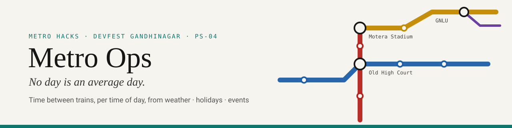
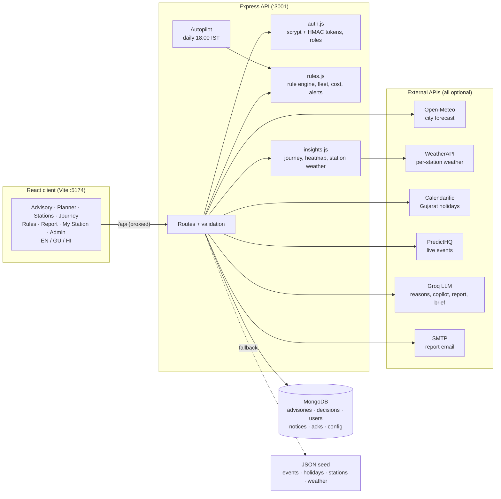
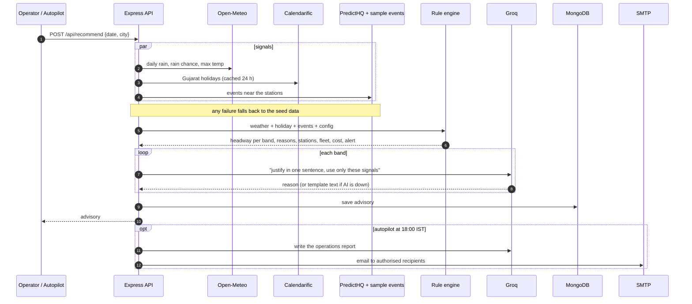
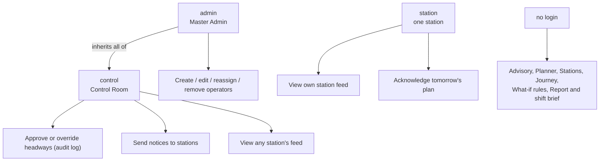
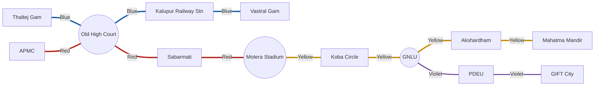

<p align="center">
  
</p>

<p align="center">
  
  
  
  
  
  
  
</p>

<h3 align="center">
  &nbsp;
  Tomorrow's train frequency for every part of the day, with a plain-language reason for each change.
</h3>

---

**Metro Ops** is a control-room tool for the **Ahmedabad and Gandhinagar metro**. It reads tomorrow's weather, public holidays and big events, then recommends the **headway** (minutes between trains) for each part of the day. It shows which stations will be busy and explains every change in one plain sentence. Operators approve or override each recommendation, and each override goes into an audit log with its reason.

Built for **Metro Hacks (DevFest Gandhinagar)**, problem statement **PS-04, "No Day Is an Average Day"**.

## Contents

- [The problem](#the-problem)
- [Features](#features)
- [Architecture](#architecture)
- [How the rule engine decides](#how-the-rule-engine-decides)
- [The network](#the-network)
- [Quick start](#quick-start)
- [Environment variables](#environment-variables)
- [Demo accounts](#demo-accounts)
- [API overview](#api-overview)
- [Offline and fallback behaviour](#offline-and-fallback-behaviour)
- [Assumptions and limitations](#assumptions-and-limitations)
- [Project structure](#project-structure)
- [Tests](#tests)
- [Team and credits](#team-and-credits)

## The problem

A metro timetable assumes every weekday is the same. Real days aren't:

- A 60,000-seat cricket match at Motera ends at 21:30 and the platform floods.
- A monsoon downpour empties the morning commute.
- On a Navratri night, crowds travel home after midnight.
- On a public holiday the office peak barely shows up.

Control rooms usually adjust frequency by gut feel, late, and without a record of why. Metro Ops turns those signals into a **per-time-of-day headway recommendation the night before**. Every number has a traceable reason, and every human override is logged.

## Features

### Control room (`control` role)
- **Advisory**: headway per band (Morning Peak, Midday, Evening Peak, Late Night) with the action (tighten / widen / hold), the stations involved and the signals behind it. Each row has an AI-written one-line reason.
- **Approve or override** each band. Overrides must stay within the allowed range and need a written reason. Every decision goes into the audit log under the operator's login name.
- **Notices** to any station, which appear in that station's feed.
- **Drift alert**: compares tonight's autopilot plan against a fresh live forecast and flags any band that changed.
- **Fleet and crew** needed at peak, plus **cost and CO₂** (train-km, energy, ₹, kg CO₂) compared with the normal timetable.
- **AI copilot**: ask questions about the advisory on screen. Answers come only from that advisory's facts.

### Station operator (`station` role)
- **My Station**: tomorrow's plan rows that affect this station, trains per hour, expected crowd surges, control-room decisions and notices.
- **Acknowledge** ("I have read tomorrow's plan"). The control room sees the acknowledgement.
- Locked to their own station. If an admin reassigns them, the change takes effect without a new login.

### Master admin (`admin` role)
- Everything the control room can do.
- **Operator management**: create, edit, reassign or remove operators and their roles. The station gets an in-app notice about the assignment. The operator is emailed if an address is set (the password is never emailed).

### Everyone
- **Planner**: a 1–14 day outlook with weather, holidays, events and flagged days. Click a day to open its full advisory.
- **Stations**: crowd heatmap (station × hour), live weather per station, and **station closure mode**. Closure mode shows the extra load on neighbouring stations, revised headways, reroutes, and where a bus bridge is needed.
- **Journey and fare planner** across 54 stations and 4 lines, with interchanges, stops, estimated time, fare and peak flag.
- **What-if rules**: change any rule value (baselines, crowd tiers, rain and heat effects, limits, cost constants) and see the result.
- **Report**: an AI-written operations report, previewed in the app and emailed only to authorised recipients.
- **Shift brief** in English, Gujarati or Hindi, short enough to paste into WhatsApp.
- **Daily autopilot** at 18:00 IST (configurable). It builds tomorrow's advisory for both cities, saves it and emails the report.
- The interface is available in **English, ગુજરાતી and हिन्दी**, and respects reduced-motion settings.

## Architecture



### "Make tomorrow's plan"

The same flow runs when an operator clicks **Generate** and when the autopilot fires each evening.



### Roles and permissions



## How the rule engine decides

[`server/rules.js`](server/rules.js) is a small, transparent rule engine with no hidden scoring. Every band starts at its baseline headway, and each signal adds or removes minutes. Negative means more frequent trains. The result is clamped to **3–15 min**.

| Band | Hours | Baseline headway (assumed) |
|---|---|---|
| Morning Peak | 06:00–10:00 | 4 min |
| Midday | 10:00–17:00 | 8 min |
| Evening Peak | 17:00–21:00 | 4 min |
| Late Night | 21:00–24:00 | 10 min |

| Signal | Condition | Effect |
|---|---|---|
| Event: exit surge | 1.5 h after the event ends | −3 min (50k+ crowd), −2 (10k+), −1 (smaller) |
| Event: arrivals | 1.5 h before the start | one step softer than the exit surge (min −1) |
| Event past midnight | ends at or after 24:00 | the late-night tightening applies to 23:00–24:00 |
| Market / sustained crowd | during the event | −1 min |
| Heavy rain | ≥ 15 mm | +2 min, every band |
| Moderate rain | ≥ 5 mm or ≥ 70 % chance | +1 min, every band |
| Extreme heat | ≥ 42 °C | +1 min, Midday |
| Public holiday or Sunday | | +2 min, Morning and Evening Peak |
| Saturday | | +1 min, Morning Peak |

An event window counts toward a band only if it overlaps that band by at least 30 min. Live events with no station list are mapped to stations by venue keyword (for example, Narendra Modi Stadium → Motera Stadium and Sabarmati). The **alert level** is `high` for a tightening of 3 min or more, or a crowd of 50k+. It is `watch` for any move of 2 min or more, or any event. Otherwise it is `ok`. Every number above can be changed on the **What-if rules** page and is stored as the active config.

The **fleet** figure is the round-trip time divided by the headway (assumed 90 min for Ahmedabad and 60 min for Gandhinagar), with 2 crew per train. **Cost and CO₂** come from train-km × 8 kWh/km × ₹8/kWh × 0.71 kg CO₂/kWh. All of these are assumed constants.

## The network

54 stations, 4 lines, 3 interchanges (station list from `server/data/stations.json`).



| Line | Route | Stations |
|---|---|---|
| Blue | Thaltej Gam ↔ Vastral Gam | 18 |
| Red | APMC ↔ Motera Stadium | 15 |
| Yellow | Motera Stadium ↔ Mahatma Mandir | 21 |
| Violet | GNLU ↔ GIFT City | 3 |

## Quick start

Requires **Node 20+**. MongoDB is optional.

```bash
npm run install:all                  # root + server + client
cp server/.env.example server/.env   # fill in what you have; every key is optional
npm run dev                          # API on :3001, web on :5174
```

Open <http://localhost:5174>. Vite forwards `/api` requests to the API on port 3001.

To run a local MongoDB with Docker: `npm run mongo` (starts `mongo:7` on port 27017). Without `MONGODB_URI`, the server tries `mongodb://127.0.0.1:27017/metro` and falls back to JSON seed data if that fails.

## Environment variables

Set these in `server/.env`. The table lists names only. Never commit real values.

| Variable | Used for | If missing |
|---|---|---|
| `MONGODB_URI` | Saved advisories, decisions, operators, notices, acks, rule config | Tries local Mongo, then in-memory + JSON seed |
| `GROQ_API_KEY` | AI reasons, copilot, report, shift brief | Template text |
| `GROQ_MODEL` | Groq model id | `openai/gpt-oss-120b` |
| `CALENDARIFIC_API_KEY` | Live Gujarat public holidays | Seed holidays |
| `PREDICTHQ_TOKEN` | Live events near Ahmedabad / Gandhinagar | Sample events only |
| `WEATHER_API_KEY` | Per-station weather (weatherapi.com) | Station weather panel unavailable |
| `SMTP_HOST`, `SMTP_PORT`, `SMTP_USER`, `SMTP_PASS` | Emailing reports and operator assignments | Email disabled |
| `REPORT_RECIPIENTS` | Comma-separated allow-list for the report | Report can be previewed, not sent |
| `AUTO_TIME` | Daily autopilot time, IST `HH:MM` | `18:00` |
| `AUTH_SECRET` | Signs login tokens | Random per start (logins end on restart) |
| `DEMO_PASSWORD` | Password for the seeded demo accounts | No accounts are seeded |
| `PORT` | API port | `3001` |

The city-level forecast uses **Open-Meteo**, which needs no key. `PARSE_API_KEY` appears in `.env.example` but the current server code does not read it.

## Demo accounts

When `DEMO_PASSWORD` is set, the server seeds these accounts on first start. They all use the **`DEMO_PASSWORD`** from your `server/.env`, and no password is stored in the repo.

| Username | Role | Station |
|---|---|---|
| `admin` | Master admin | — |
| `control` | Control room | — |
| `motera` | Station | Motera Stadium |
| `kalupur` | Station | Kalupur Railway Station |
| `oldhighcourt` | Station | Old High Court |
| `sabarmati` | Station | Sabarmati |
| `mahatmamandir` | Station | Mahatma Mandir |
| `giftcity` | Station | GIFT City |

Tokens last 12 h. A username is locked for 10 minutes after 5 failed logins.

## API overview

Full contract: **[API.md](API.md)**. Errors always return `{ "error": "message" }`.

| Area | Endpoints | Auth |
|---|---|---|
| Meta | `GET /api/meta`, `GET /api/live-events` | — |
| Advisory | `POST /api/recommend`, `POST /api/ask`, `GET /api/history` | — |
| Planner | `POST /api/plan` | — |
| Rules | `GET /api/config`, `PUT /api/config` | — |
| Network | `GET /api/stations`, `GET /api/stations/weather`, `GET /api/journey`, `POST /api/heatmap` | — |
| Disruption & drift | `POST /api/disruption`, `GET /api/drift` | — |
| Report & brief | `POST /api/report/preview`, `POST /api/report/send`, `POST /api/brief` | — (send is limited to the allow-list) |
| Autopilot | `GET /api/auto`, `POST /api/auto/run` | — |
| Login | `POST /api/auth/login`, `GET /api/auth/me`, `GET /api/auth/accounts` | — / token |
| Decisions | `POST /api/decisions` · `GET /api/decisions` | control · — |
| Station feed | `GET /api/station-feed`, `POST /api/station-feed/ack` | any login · station |
| Notices | `POST /api/notices` | control |
| Admin | `GET/POST /api/admin/operators`, `PATCH/DELETE /api/admin/operators/:username` | admin |

## Offline and fallback behaviour

The demo should never hard-fail, so each dependency degrades on its own:

| If this is unavailable | The app does this |
|---|---|
| MongoDB | Seed JSON for events/holidays; decisions, notices, acks, users and config kept in memory; history empty |
| Open-Meteo | Fixture weather (`sample_weather.json`), labelled `source: "fallback"` |
| Calendarific | Seed holiday list |
| PredictHQ | Sample events only |
| WeatherAPI | Station weather panel shows "unavailable"; failed stations are retried 3× |
| Groq | Template reasons, report and English shift brief (`ai: false`) |
| SMTP / recipients | Report preview still works; sending is disabled |

The status bar in the app header shows whether the database, AI and email are on or off. You can also force **rain** or **clear** weather to rehearse a scenario.

## Assumptions and limitations

This is a hackathon prototype. It uses **no official GMRC data**.

- **Baseline headways** (4 / 8 / 4 / 10 min), **fares** (distance slabs), **fleet** (round-trip times, 2 crew per train) and **cost / CO₂** constants are estimates. They are written out in the code and can be edited on the What-if page.
- **Station coordinates** are approximate (from OpenStreetMap), so journey distances, times and fares are estimates too.
- **Crowd heatmap** values are a heuristic index (commute shape × interchange weight + event surges), not measured ridership.
- **Event impact** depends only on attendance tiers and time windows. Live events without a station list are mapped by venue keyword, or ignored when no keyword matches.
- **Closure mode**: the network has no loops, so closing a station in the middle of a line always means a bus bridge.
- **Access control**: only decisions, notices, station feeds and operator management need a login. The advisory, rule config, report and autopilot endpoints are open, so put the app behind a gateway before any real deployment. Login rate-limiting is held in memory, per server.
- AI text is constrained to the given facts, but should still be checked by a person before acting.

## Project structure

```
MetroOps/
├── package.json            # install:all, dev, test, mongo scripts
├── API.md                  # API contract
├── docs/                   # logo.svg, banner.svg
├── server/                 # Express API (ES modules, Node 20+)
│   ├── index.js            # routes, data fetchers, Groq, autopilot, auth routes
│   ├── rules.js            # rule engine, fleet, cost/CO2, alert, station surges
│   ├── insights.js         # journey planner, crowd heatmap, station weather
│   ├── auth.js             # password hashing, tokens, demo users
│   ├── rules.test.js       # rule engine + journey tests
│   ├── auth.test.js        # auth tests
│   ├── .env.example
│   └── data/               # stations.json, events.json, holidays.json, sample_weather.json
└── client/                 # React 18 + Vite + Framer Motion
    └── src/
        ├── App.jsx         # shell, nav, language switch, hash routing
        ├── i18n.js         # English / Gujarati / Hindi strings
        ├── ui.jsx, charts.jsx, styles.css
        └── pages/          # Advisory, Planner, Stations, Journey, Rules,
                            # Report, MyStation, Login, Admin
```

## Tests

The tests use the built-in Node test runner and need no extra dependencies:

```bash
npm test            # from the repo root
# or
cd server && node --test
```

They cover a normal weekday, the cricket exit surge, heavy rain, headway clamping, events running past midnight, config overrides, alert levels, venue-keyword mapping, cost deltas, journeys around closed stations, password hashing and token tampering.

## Team and credits

Built by **[@developermeetratwani](https://github.com/developermeetratwani)** for **Metro Hacks, DevFest Gandhinagar** (PS-04).

Data and services: [Open-Meteo](https://open-meteo.com), [WeatherAPI.com](https://www.weatherapi.com), [Calendarific](https://calendarific.com), [PredictHQ](https://www.predicthq.com), [Groq](https://groq.com), and station positions from [OpenStreetMap](https://www.openstreetmap.org) contributors. Line colours follow the public Ahmedabad–Gandhinagar metro map. This project is not affiliated with GMRC.
